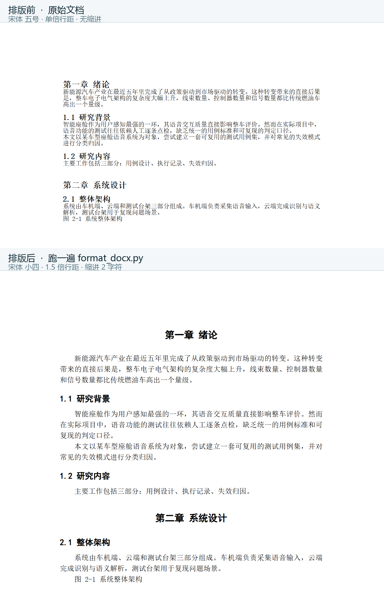

# 论文格式一键排版

帮同学改论文格式时发现，真正耗时的不是「改」，而是**判断哪一条不合格**：
字号差半号、行距差 0.25、首行没缩进，肉眼看不出来，只能一条条对着要求量。

后来换了个做法：把「合格」的标准写成配置文件，让程序去比对，人只看结果。

> **不想装 Python？** 到 [Releases](../../releases) 下载 `论文排版工具.exe`，双击就能用。
> 详细步骤见 [使用说明.md](使用说明.md)。

## 现在能做什么

一条命令，按规则把整篇论文的格式刷一遍：

```bash
python format_docx.py 我的论文.docx
```

输出 `我的论文-已排版.docx`，原文件不动。

覆盖范围：

| 类别 | 项目 |
|---|---|
| 页面 | A4 纸张、上下左右页边距、页脚页码 |
| 正文 | 中文字体、英文字体、字号、行距、段前段后、首行缩进、对齐方式 |
| 标题 | 一级 / 二级 / 三级，各自独立配置字体字号加粗与间距 |
| 其他 | 图题表题（Caption 样式）、参考文献（Bibliography 样式） |

## 效果

同一份文档，跑一遍前后的对比。



跑完之后正文变成宋体小四、1.5 倍行距、首行缩进 2 字符，标题换成黑体居中。
页脚也会自动加页码——这条在图里看不到（只截了正文区），打开输出文件才有效果。

<sub>图为按文档实际样式参数渲染的预览，与在 Word / WPS 中打开的效果一致。</sub>

## 怎么用

**1. 装依赖**

```bash
pip install python-docx pyyaml
```

**2. 改 `rules.yaml`**

文件里每一项都有中文注释，字号支持直接写「小四」「三号」这种中文号数，也支持写 12、16 这种磅值。

**3. 跑**

```bash
python format_docx.py 我的论文.docx
```

**4. 用 Word 打开输出文件核对**

## 前提：你的标题得用「样式」

工具改的是 Word 的**样式表**，所以标题必须是用 Word 的「标题 1 / 标题 2」标出来的，
不能用「选中文字 → 加粗 → 字号调大」手动做。

**怎么检查：** 跑一遍，看输出里的「一级标题段落」是不是 0。如果是 0，说明没识别到。

**怎么改：** 在 Word 里选中标题 → 开始 → 样式 → 标题 1（快捷键 `Ctrl+Alt+1`）。
二级是 `Ctrl+Alt+2`，三级是 `Ctrl+Alt+3`。

## 文件说明

| 文件 | 作用 |
|---|---|
| `format_docx.py` | 主程序 |
| `rules.yaml` | 格式规则。改这个不用改代码 |
| `make_test_doc.py` | 生成一份格式很乱的测试文档，用来验证效果 |
| `checklist.md` | 20 条人工自查清单，工具查不出的项目用它兜底 |
| `examples/` | 排版前后的示例文档，可以先跑这个看效果 |
| `docs/` | README 里用的对比图 |

## 已知限制与取舍

这一节不是免责声明。下面每一条都是设计时做过的判断，写清原因和代价。

### ① 只改样式表，不逐段改格式

**原因：** 逐段改的话，用户后来在 Word 里新加一段，格式又会变回去；改样式表是「一处改、全文生效」。

**代价：** 手动加粗放大做出来的标题识别不了，必须先改成 Word 的标题样式。

**取舍：** 宁可要求用户花 10 秒按 `Ctrl+Alt+1`，也不写一个「猜标题」的启发式规则——
猜错了会把正文误判成标题，比不改更麻烦。

### ② 不解析学校发的格式要求文档，只读 YAML

**原因：** 格式要求是人写的自然语言，「正文小四、行距 1.5 倍、段前 0 段后 0」这句话，程序读不懂；
让模型去抽取一定会出错，而格式错了比不排版更糟。

**代价：** 用户要手填一次配置，大约 5 分钟。

**取舍：** 手填 5 分钟，比「自动解析错了再人工逐条找错」可靠。
后续版本会加模型抽取，但「人工确认」这一步不会省。

### ③ 页脚已有内容时跳过页码

**原因：** 学校模板的页脚经常有「XX 学院毕业论文」这类字样，直接覆盖会丢内容。

**代价：** 这类文档需要用户自己去 Word 里加页码。

**取舍：** 宁可少做一步，也不做破坏性操作。工具出错最多是不生效，不能是「把别人的东西弄没了」。

### ④ 参考文献只认 `Bibliography` 样式

**原因：** 参考文献格式差异极大（GB/T 7714、APA、IEEE），硬编码一种会误导用户。

**代价：** 多数中文论文的参考文献是手动排的，用不上这一项。

**取舍：** 先不做。等真的有人需要，再按那种格式单独支持，而不是做一个「大概对」的版本。

### ⑤ 表格内部、图片尺寸不动

**原因：** 表格的规则比段落复杂得多——跨页重复表头、单元格边距、行高最小值、文字垂直居中，
每一条都能单独出问题。做一半比不做更糟。

**代价：** 表格多的论文仍需人工检查。

**取舍：** 明确写进限制，让人知道边界在哪，比让人自己去试出来要好。

## 为什么做这个

作者是新能源汽车技术专业在读，方向是车载 AI 的测试与评测。

做这个工具的起点很具体：帮同学改论文格式，发现真正花时间的不是「改」，
而是「判断哪一条不合格」——这跟测试里的手工点检是同一个问题：
**标准在心里，全靠人逐条比，人和人之间还不一致。**

所以换了个做法：把标准搬到文件里，让程序去比。

三个环节，对应测试工作里的三件事：

| 这个项目 | 测试里的对应物 |
|---|---|
| `rules.yaml` 定义「什么算合格」 | 预期结果 / 断言 |
| `format_docx.py` 逐项套用并核对 | 执行用例 |
| 检测不到标题样式时给出具体指引 | 失败归因，而不只是报错 |

谈不上复杂。但把「规则从人脑子里搬到配置文件里」这件事完整走了一遍——
包括想清楚哪些不做、为什么不做的理由。
